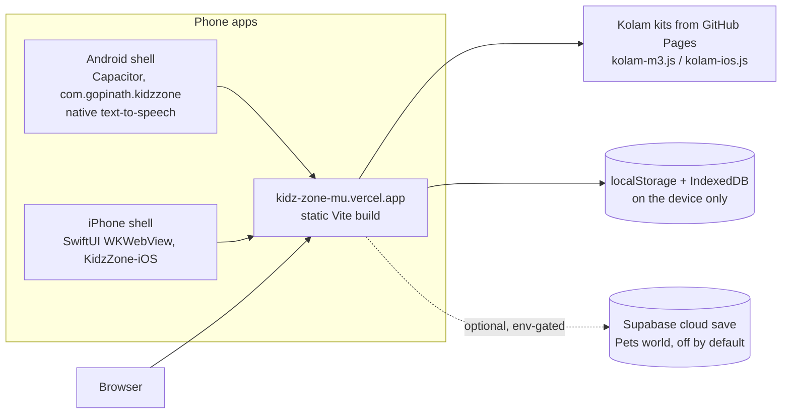
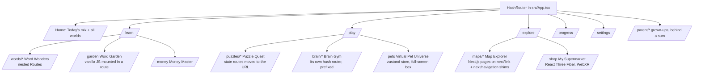
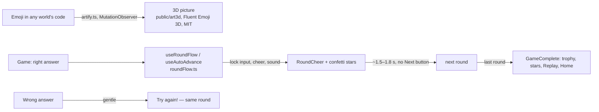
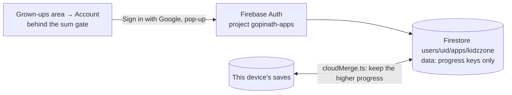
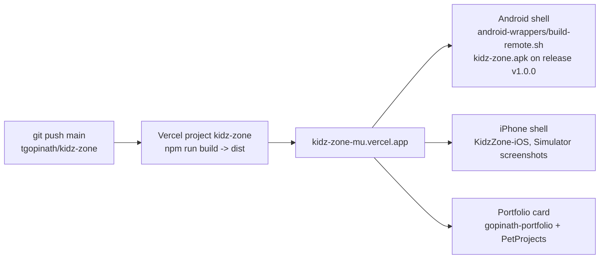

# KidZ Zone architecture

KidZ Zone brings eight children's apps into one Vite + React 19 + TypeScript app: Word Wonders, Word Garden,
Money Master, Puzzle Quest, Brain Gym, Virtual Pet Universe, Map Explorer and My Supermarket. Each became a
**world**: its code was copied in (the source folders were not changed), mounted under one router, and given
the same type, palette, frame and settings. A thin shared layer owns the child profile, settings, progress
summary, Today's mix and the grown-ups area.

## System



- No server, no account. Everything is saved on the device. The Pets world keeps its optional Supabase cloud
  save behind `VITE_SUPABASE_URL` / `VITE_SUPABASE_ANON_KEY` (not set, so it is off).
- In the Android app the Kolam M3 kit draws a Material 3 top app bar and navigation bar; in the iPhone app the
  Kolam iOS kit draws an Apple HIG navigation bar and tab bar. In a browser neither switches on
  (`?app=android`, `?app=ios`, `?app=web` preview them). See `src/shared/native.ts`.

## Worlds and routing



| World | Source | How it was brought in |
|---|---|---|
| Words | `vocab-builder` (Word Wonders) | Routes nested under `/words`; absolute links prefixed; NavBar replaced by the world bar; its Parent screen is reused in the grown-ups area. |
| Word Garden | `word-garden` | The original `app.js` wrapped in `mountGarden(root, liveRegion, opts)`; its CSS scoped under `.w-garden` by `tools/scope-css.mjs`. Name, sound and voice come from the shared layer. |
| Money | `money-master` | Header replaced by the world bar; challenges report stars and add ₹20 to the shared play-money jar. |
| Puzzles | `puzzle-quest` | Screen state (home / play / parent) moved into the URL; its global CSS scoped under `.w-puzzles`; its PIN gate replaced by the shared grown-up check. |
| Brain Gym | `brain-gym` | Its tiny hash router now parses `#/brain/…`; its utilities renamed (`bcard`, `bbtn`…) so they never clash with Puzzle Quest's `.card` / `.btn`. |
| Pets | `virtual-pet-universe` | Fixed full-screen root became a box under the world bar; game, trick and care actions report to the shared progress. |
| Maps | `india-map-explorer` | Next.js app-router pages mounted as routes; `@/…`, `next/link` and `next/navigation` resolve to small shims (`src/worlds/maps/next-shim`) that add the `/maps` prefix. Boundary data in `public/maps/data`. |
| Shop | `virtual-supermarket` | Session screens unchanged; the 3D store fills the world's box; quizzes and shopping trips report to the shared progress; the jar can be swapped for shop coins. |

Every world is lazy-loaded (`React.lazy`), so Home ships about 100 kB of JavaScript and the 3D supermarket's
three.js code loads only in the Shop.

## Shared profile and progress

```mermaid
flowchart LR
  subgraph World saves, original keys
    a[wordwonders:v1] --- b[word-garden-v2] --- c[money-master:*] --- d[puzzle-quest/v1]
    e[braingym:v1] --- f[vpu-save-v1] --- g[imx-progress-v1] --- h[(IndexedDB virtual-supermarket-progress)]
  end
  W[World code] -- record(world, id, stars, xp, level) --> S[(kidzzone:v1<br/>src/shared/store.ts)]
  W -- reads name, age, sound, voice --> S
  S --> HM[Home: totals, streak, level]
  S --> MX[Today's mix<br/>src/shared/dailyMix.ts]
  S --> PA[Grown-ups: 14-day chart, per-world table, reset]
  PA --> WD[Each world's own dashboard<br/>Word Wonders, Puzzle Quest, Brain Gym, Map Explorer, My Supermarket]
```

- **Profile:** name, age band (4–6, 7–9, 10–12) and an initials badge colour. Each world's own profile is
  mirrored from it (Brain Gym and Puzzle Quest age groups, Word Wonders difficulty, the shop's age band).
- **Progress:** `record()` adds an activity to a capped log and to the world's summary (stars 0–3, XP, plays,
  the world's own level label). Totals, the player level, the streak and the parent chart are pure functions of it.
- **Today's mix:** four activities from four different worlds that suit the age band, seeded by the date and the
  child's name and stored once per day. An item is done when the world records a matching activity today.
- **Settings:** sound, reading voice speed, text size and reduced motion, read by every world.
- **First run:** `src/shared/legacy.ts` summarises any saves the original apps left on the same origin (they
  lived on their own domains, so on kidz-zone's domain this normally finds nothing). It runs once per device.

## Big, touch-first play (shared play kit, `src/play`)

Since November 2026 every world sits on one play kit, so all games look and behave alike for young children:



- **Pictures:** `tools/art3d.mjs` scans the source for every emoji (and Map Explorer's run-time flags) and copies
  only those Fluent Emoji 3D pictures (256 px WebP, from `@lobehub/fluent-emoji-3d`) into `public/art3d`
  (924 pictures, about 5 MB, loaded lazily and cached by the service worker). `src/play/artify.ts` swaps emoji
  text for the pictures across the whole app, Word Garden's vanilla JS included, without touching React's own text
  nodes; a square card holding only a picture gets `kz-fill` so the picture fills ~75% of it. `<Art3D>` draws one
  directly. Emoji without a picture (5 rare flags) stay emoji. Letters and numbers are big colourful type.
- **Sizes:** `play.css` scales the root font with the screen (`clamp(17px, 12.5px + 0.95vmin, 24px)`), widens the
  content column to ~90% of the window, and gives every control in `#main` a 64 × 64 px minimum (88–96 px for
  main game buttons). Boards with many cells opt out with `data-board`.
- **Rounds:** `useRoundFlow` (React) / `createRoundFlow` (plain TS, used by Word Garden) — success locks input,
  cheers, then loads the next round by itself; a miss says "Try again!" and keeps the round; the last round shows
  `GameComplete` with Replay. Worlds that already know when a round ends use `useAutoAdvance`.
  Unit tests: `src/play/roundFlow.test.ts`, `src/play/art.test.ts`.
- **Feedback:** `feedback.ts` — synthesised sounds (Settings → Sound), a short vibration on Android, confetti
  stars; all still with Reduce motion.
- **Testing:** `tools/playall.mjs` plays every game start to finish at 375×667, 414×896, 768×1024, 1024×768,
  1440×900 and 1920×1080 in headless Chrome (test mode `?kztest=1` marks the right answers, see
  `src/play/testMode.ts`) and checks scrolling, 64 px targets, covered controls, automatic rounds, the end screen
  and console errors.

## Optional sign-in for grown-ups (`src/shared/cloud.ts`)



- Never a wall: children play without it; only the grown-ups area offers it. Same schema and project as Kolam Auth.
- On sign-in the cloud copy and this device are merged (per world the side with more XP wins, logs joined, the
  larger jar kept) and saved both ways; later changes save after 1.5 s. Sign-out keeps everything on the device.
- Synced keys: `kidzzone:v1` and each world's save (Word Wonders, Word Garden, Money Master, Puzzle Quest, Brain Gym,
  Virtual Pet Universe, Map Explorer). My Supermarket keeps its IndexedDB progress on the device.
- Web uses a pop-up. An address that is not in Firebase → Authentication → Authorized domains gets
  "Sign-in isn't set up for this address yet". The Android app uses the native `@capacitor-firebase/authentication`
  plugin when its shell has it (not yet: it needs the Android app registered in Firebase); the iPhone app hides the
  button for now. Both say to sign in on the website instead.

## Build and deploy



- `npm test` runs the play kit tests (round flow, picture map), the cloud merge tests, the shared-layer tests (profile, progress, Today's mix, first-run import) and the source apps'
  own engine tests (Puzzle Quest adaptive engine and store, Money Master currency and challenges, My Supermarket
  engine).
- `npm run build` type-checks and builds. `node tools/check.mjs` opens every world headless in web, Android and
  iPhone modes and fails on console errors. `node tools/playall.mjs` plays every game at six sizes.
  `node tools/shots.mjs` captures the portfolio screenshots.
